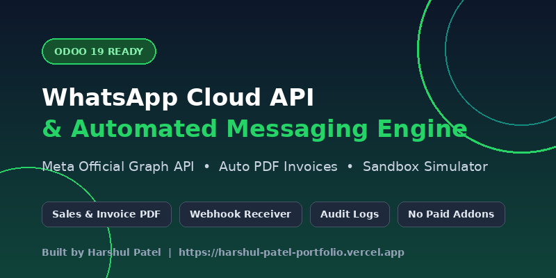
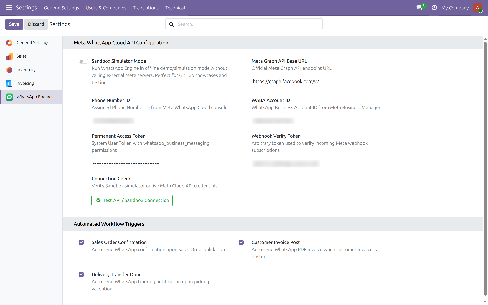
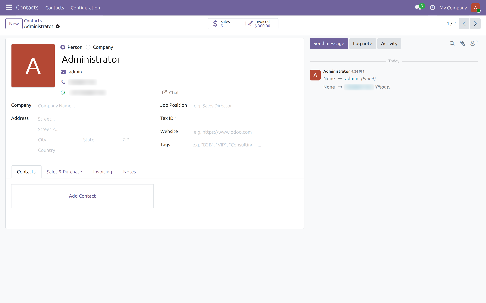
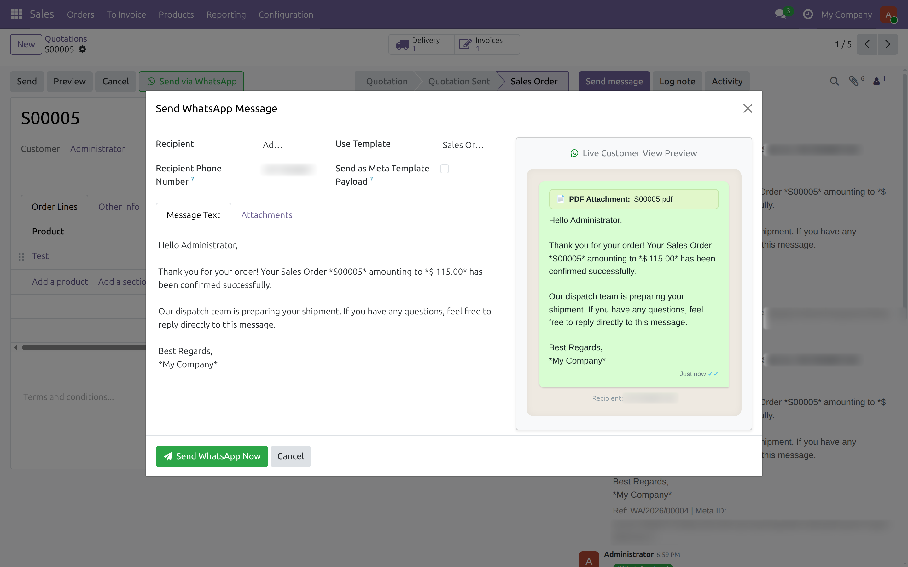
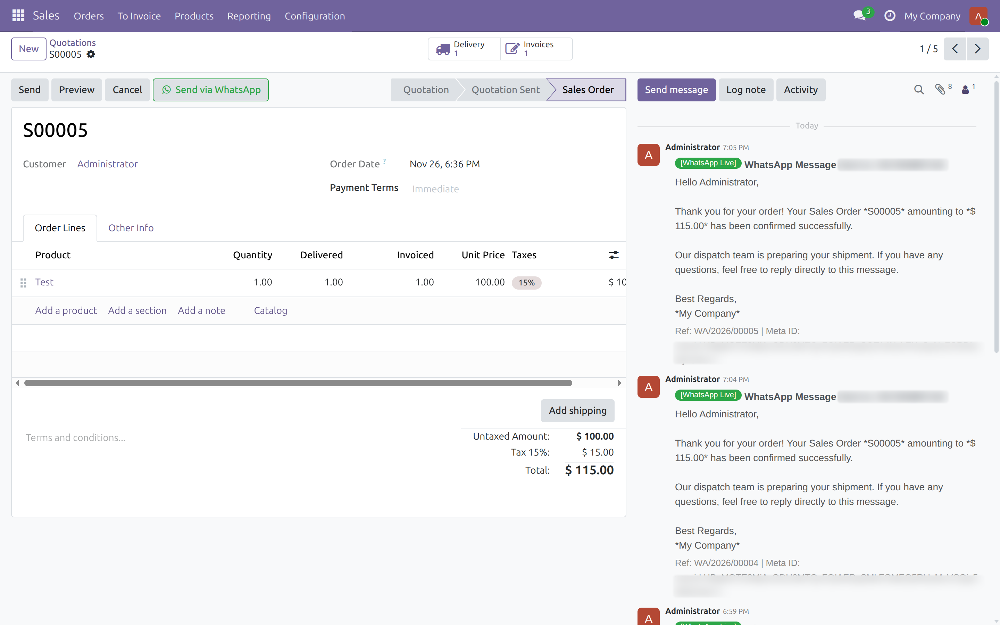
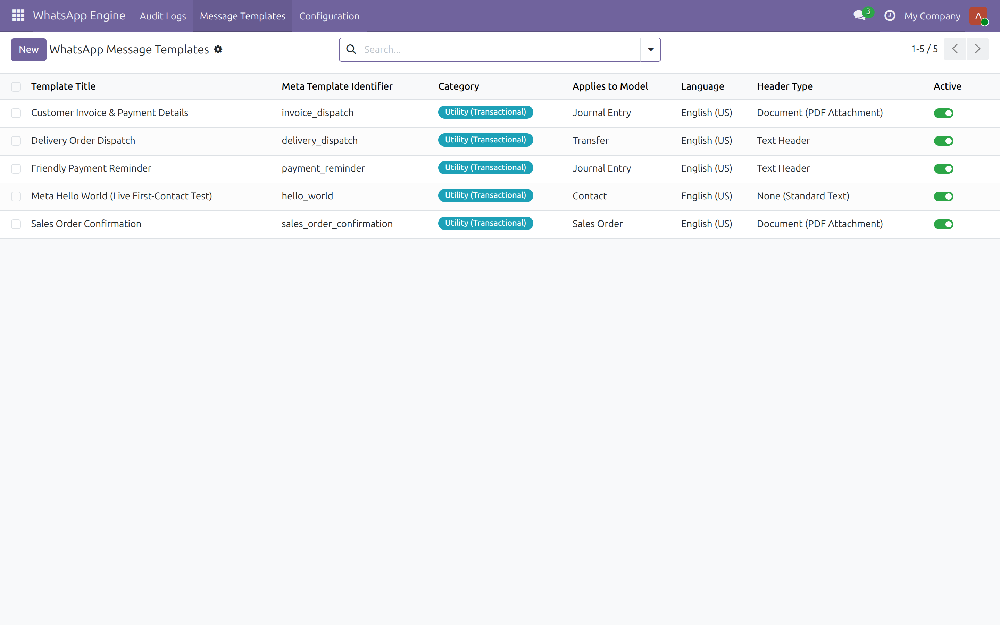
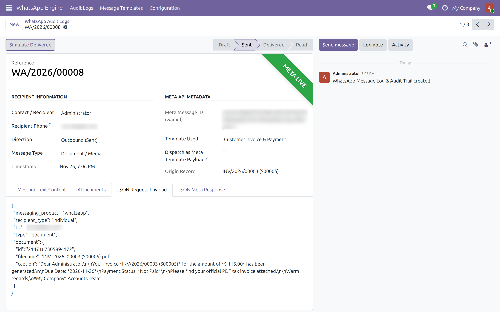

# 🚀 WhatsApp Cloud API & Automated Messaging Engine (Odoo 19)

[](https://odoo.com)
[](https://python.org)
[](https://developers.facebook.com)
[](https://www.gnu.org/licenses/lgpl-3.0)
[]()

> **Enterprise-Grade, Meta-Approved WhatsApp Cloud API Connector for Odoo 19.**  
> Built to eliminate expensive 3rd-party aggregator subscriptions (Twilio/Wati) by connecting directly to Meta's official Graph API. Includes a **zero-configuration local sandbox simulation engine** for testing out-of-the-box!

---

## 🌟 Executive Summary & Business Impact

For small to enterprise-scale businesses (Manufacturing, Logistics, Retail, and Real Estate), sending real-time transactional updates is critical for customer retention. Standard Odoo requires manual email sending or costly proprietary addons.

This module provides an **end-to-end automated WhatsApp pipeline**:
1. **Zero-Subscription Overhead:** Direct integration with Meta's Free Tier WhatsApp Cloud API.
2. **Automated Document Dispatch:** Auto-renders high-resolution QWeb PDF invoices, order confirmations, and delivery dispatch tracking directly to customer WhatsApp numbers.
3. **Dual Execution Engine:**
   - **⚡ Live Cloud Mode:** Real-time production dispatch to customer devices.
   - **🧪 Sandbox Simulator Mode:** Test all features locally with simulated JSON payloads, mock delivery events, and chatter history **without needing any Meta account or API keys**.

---

## 🛠️ Key Architectural Features

```
+-----------------------------------------------------------------------------------+
|                                  ODOO 19 CORE                                     |
|  [Sale Orders]     [Invoices (account.move)]     [Stock Transfers]    [Contacts]  |
+---------+--------------------+---------------------------+----------------+-------+
          |                    |                           |                |
          v                    v                           v                v
+-----------------------------------------------------------------------------------+
|                       WHATSAPP CLOUD API ENGINE (ORCHESTRATOR)                    |
|  - Dynamic Placeholder Evaluator ({{partner_name}}, {{amount_total}}, etc.)       |
|  - Automatic QWeb PDF Report Generator (Base64 Binary Stream)                     |
|  - International Phone Sanitizer (E.164 Validator)                               |
+-----------------------------------+-----------------------------------------------+
                                    |
            +-----------------------+-----------------------+
            |                                               |
  [Live Mode Active]                              [Sandbox Simulator Active]
            |                                               |
            v                                               v
+-----------------------+                       +-----------------------+
|  Meta Graph API v19+  |                       | Internal Mock Engine  |
|  (HTTPS Post / Media) |                       | (Mock wamid, JSON Log)|
+-----------+-----------+                       +-----------+-----------+
            |                                               |
            +-----------------------+-----------------------+
                                    |
                                    v
+-----------------------------------------------------------------------------------+
|                            CENTRAL AUDIT TRAIL LOG                                |
|  - whatsapp.message.log: (Draft -> Queued -> Sent -> Delivered -> Read -> Failed) |
|  - Bi-directional Webhook Handler: /whatsapp/webhook                              |
|  - Origin Document Chatter Integration (Badges & Timestamps)                      |
+-----------------------------------------------------------------------------------+
```

### 1. Automated Workflow Triggers
- **Sales Order Confirmed:** Automatically dispatches order confirmation alert.
- **Invoice Posted:** Auto-compiles official Tax Invoice PDF and sends directly to customer.
- **Delivery Validated:** Alerts customer with dispatch details and scheduled delivery date.
- **Automated Overdue Payment Reminders:** Built-in scheduled action (`ir.cron`) identifies overdue invoices and sends friendly reminder notifications.

### 2. Interactive WhatsApp Composer Wizard
- Modal window accessible directly from Sale Order, Invoice, or Delivery Order headers.
- **Live WhatsApp Chat Bubble Preview:** Displays real-time message layout, attachment indicators, and delivery ticks before sending.
- Dynamic template selection with on-the-fly placeholder rendering.

### 3. Central Audit Log & Bi-Directional Webhooks
- Complete tracking of outbound and inbound messages.
- Full JSON request payload and response inspector for enterprise auditing.
- Dedicated `/whatsapp/webhook` controller handling Meta's challenge verification and live status callbacks (`delivered`, `read`, `failed`).

---

## 🚀 Quickstart & Installation

### 1. Clone into your custom addons directory:
```bash
cd /path/to/odoo19/custom_addons
git clone https://github.com/harshulpatel2017/odoo19-whatsapp-cloud-api-engine.git whatsapp_cloud_api_engine
```

### 2. Update Odoo Addons List:
1. Restart your Odoo 19 service.
2. Log into Odoo with Developer Mode enabled.
3. Navigate to **Apps** ➡️ click **Update Apps List**.
4. Search for `WhatsApp Cloud API & Automated Messaging Engine`.
5. Click **Activate / Install**.

---

## 🧪 Testing with the Built-In Sandbox Simulator (No API Keys Required!)

You can demonstrate and test the full feature set immediately after installation:
1. Go to **Settings ➡️ WhatsApp Engine**.
2. Notice **Enable Sandbox Simulator Mode** is turned **ON** by default.
3. Open any **Sales Order** or **Customer Invoice**.
4. Click the green **"Send via WhatsApp"** button in the header.
5. Review the live customer chat preview and click **Send WhatsApp Now**.
6. Open **WhatsApp Engine ➡️ Audit Logs**:
   - Inspect the generated message reference (`WA/2026/00001`).
   - Click **Simulate Delivered** and **Simulate Read** to demonstrate live status transitions to clients!
   - Review the document chatter to see the verified timestamp badge.

---

## 🌐 Connecting to Live Meta WhatsApp Cloud API (Production)

When ready for live customer messaging:
1. Visit [Meta for Developers](https://developers.facebook.com/) and create a Business App.
2. Under **WhatsApp ➡️ Getting Started**, obtain your:
   - **Phone Number ID**
   - **WhatsApp Business Account (WABA) ID**
   - **System User Permanent Access Token**
3. In Odoo, navigate to **Settings ➡️ WhatsApp Engine**:
   - Toggle **Enable Sandbox Simulator Mode** to **OFF**.
   - Paste your **Phone Number ID** and **Access Token**.
   - Click **Test API Connection** to verify live communication with Meta.
4. Set up Webhooks:
   - Webhook Callback URL: `https://your-odoo-domain.com/whatsapp/webhook`
   - Verify Token: enter your configured `whatsapp_webhook_verify_token`.

---

## 📁 Repository Structure

```
whatsapp_cloud_api_engine/
├── __init__.py
├── __manifest__.py
├── README.md
├── controllers/
│   ├── __init__.py
│   └── main.py                     # Webhook verification & incoming status listener
├── data/
│   ├── ir_cron_data.xml            # Retry queue & payment reminder cron jobs
│   ├── ir_sequence_data.xml        # Unique reference generator (WA/YYYY/XXXXX)
│   └── whatsapp_template_data.xml  # Pre-configured transactional templates
├── models/
│   ├── __init__.py
│   ├── account_move.py             # Invoice auto-send & WhatsApp action
│   ├── res_config_settings.py      # Meta API settings & Sandbox toggles
│   ├── res_partner.py              # International phone sanitizer (E.164)
│   ├── sale_order.py               # Order confirmation trigger & WhatsApp action
│   ├── stock_picking.py            # Delivery dispatch trigger & WhatsApp action
│   ├── whatsapp_message_log.py     # Core dispatch engine & audit trail
│   └── whatsapp_template.py        # Meta template mapper & PDF attachment generator
├── security/
│   ├── ir.model.access.csv         # Role-based access control (User vs Admin)
│   └── whatsapp_security.xml       # Security category and user groups
├── static/
│   └── description/
│       ├── banner.png              # Apps Store hero banner
│       ├── icon.png                # High-res WhatsApp engine icon
│       ├── index.html              # Visual Odoo module detail documentation
│       └── 01..06_*.png            # Live workflow screenshots
├── views/
│   ├── account_move_views.xml      # Invoice header button
│   ├── res_config_settings_views.xml # Settings interface
│   ├── res_partner_views.xml       # Partner WhatsApp quick-chat action
│   ├── sale_order_views.xml        # Sales Order header button
│   ├── stock_picking_views.xml     # Stock transfer header button
│   ├── whatsapp_menu_views.xml     # Top-level application menu & submenus
│   ├── whatsapp_message_log_views.xml # Rich message log & JSON inspector
│   └── whatsapp_template_views.xml # Template editor views
└── wizard/
    ├── __init__.py
    ├── whatsapp_composer.py        # Interactive message composer & preview model
    └── whatsapp_composer_views.xml # Interactive WhatsApp modal view
```

---

## 📸 Visual Workflow & Screenshots (Odoo 19 Live Showcase)



### 1. Settings Configuration & Automated Workflow Triggers


### 2. Odoo 19 E.164 Phone Sanitization & One-Click Chat


### 3. Interactive Composer Modal with Live Customer Preview & PDF Attachment


### 4. Real-Time Chatter Audit Badges (`[WhatsApp Live]` / `[WhatsApp Sandbox]`)


### 5. Pre-Configured Template Engine


### 6. Central Audit Logs, Webhook Lifecycle & Raw Meta JSON Payload Inspector


---

## 👨‍💻 Author & Technical Inquiries

Developed with high standards for clean architecture, upgrade safety, and multi-company scalability.

**Harshul Patel**  
*Senior Odoo Developer & Full Stack Web Specialist*  
- 📍 **Location:** Vadodara, Gujarat, India  
- 🌐 **Portfolio:** [harshul-patel-portfolio.vercel.app](https://harshul-patel-portfolio.vercel.app)  
- 💼 **LinkedIn:** [harshul-patel](https://www.linkedin.com/in/harshul-patel-94658a407)  
- 📧 **Email:** [harshulpatel2017@gmail.com](mailto:harshulpatel2017@gmail.com)  
- 📱 **WhatsApp:** [+91 7203857143](https://wa.me/917203857143)

*Available for custom Odoo ERP implementations, module engineering, API connectors, and bespoke web platforms.*
